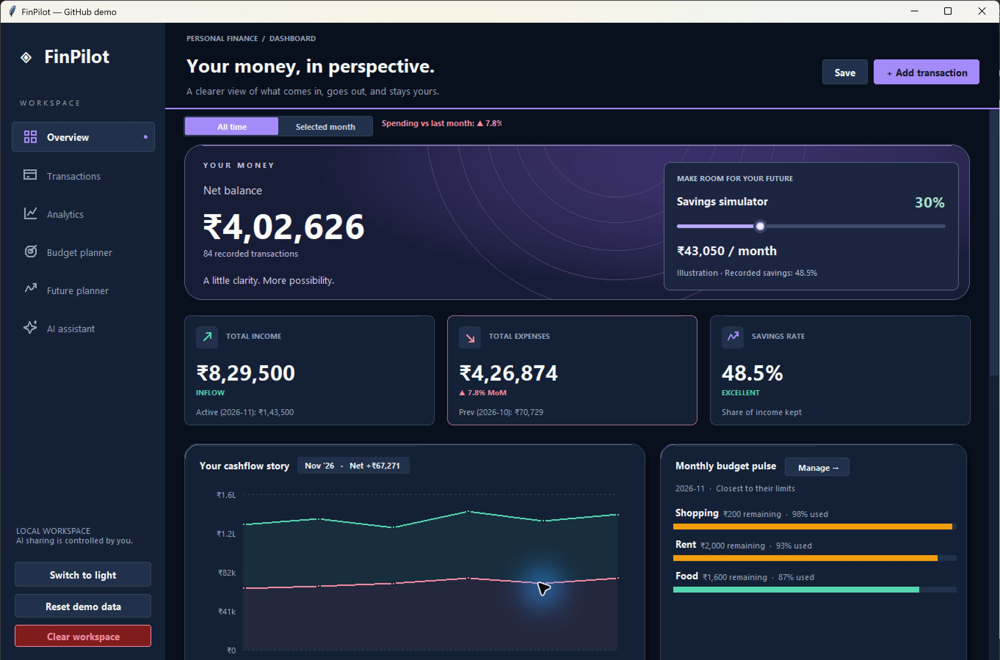
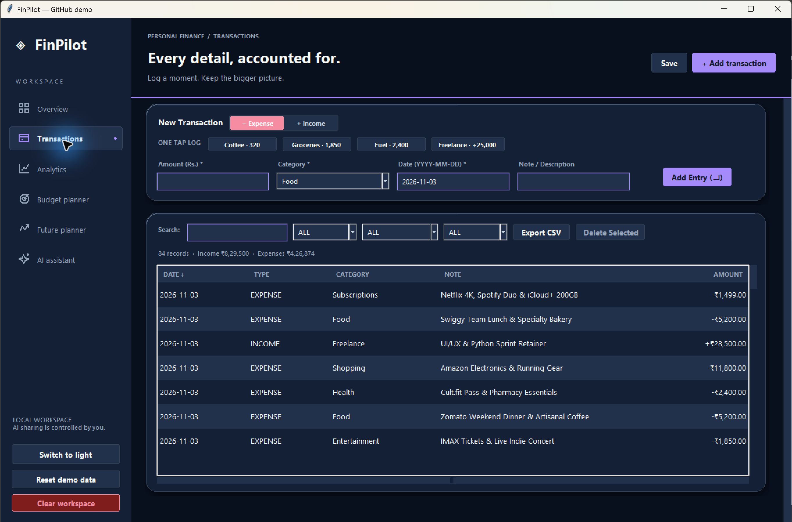
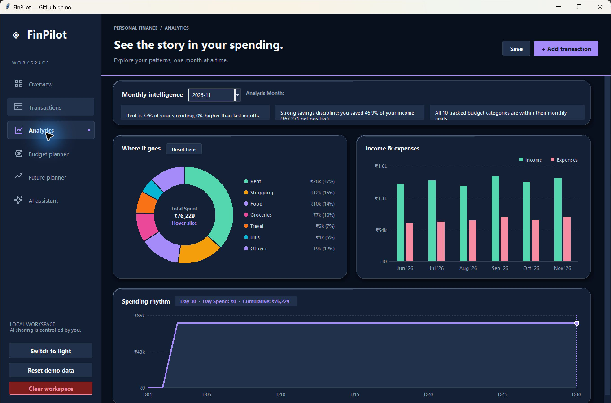
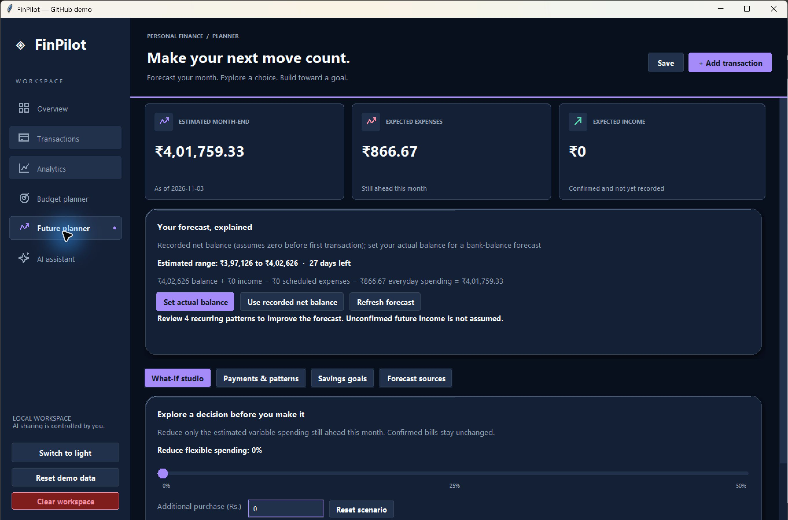
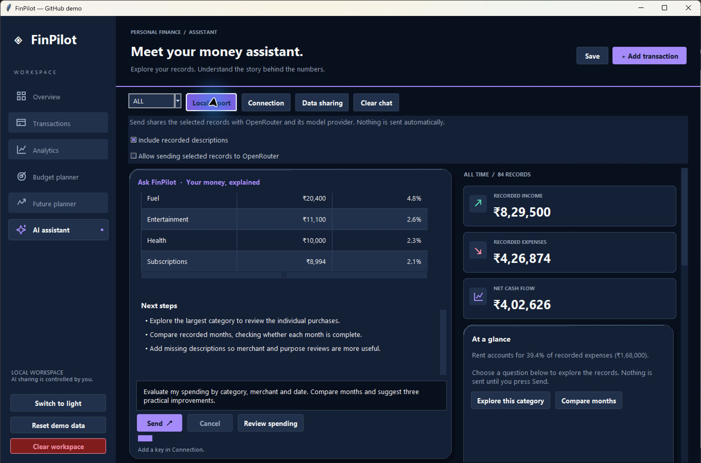
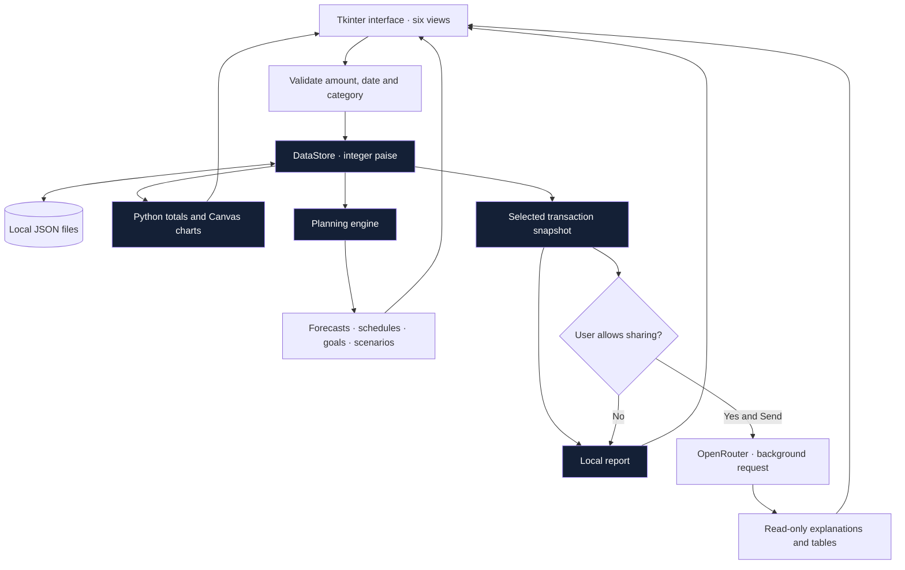
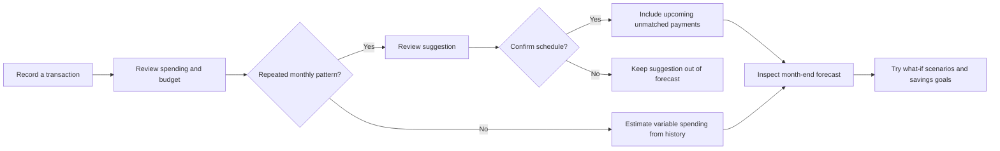

<div align="center">

# ✦ FinPilot

### Your money, in perspective.

A native Python desktop workspace for tracking spending, planning ahead, and understanding your money.


[Get started](#get-started) · [Explore the app](#six-screens-one-workspace) · [How it works](#how-it-works) · [Tests](#verification) · [Team](#team)



*Actual desktop captures using generated demo records. No personal transactions or API keys are included.*

</div>

## Why FinPilot

Recording an expense is only the beginning. FinPilot connects your ledger to category charts, monthly budgets, savings goals and explainable forecasts, then adds an optional conversational layer for exploring your recorded history.

The app runs directly in Tkinter: no browser, web server or Node.js is required. Its navy-and-purple interface uses custom Canvas components, subtle card depth, interactive charts and layouts that rearrange as the window narrows.

## Six screens, one workspace

| Screen | What you can do |
| :--- | :--- |
| **Overview** | Review recorded balance, income, expenses, savings rate, recent activity and budget status. Explore the savings illustration. |
| **Transactions** | Add income or expenses, use one-tap presets, search, filter, sort, export CSV, and undo deletion. |
| **Analytics** | Compare monthly income and expenses, inspect category shares, and explore daily spending. |
| **Budget planner** | Set category limits and see spending, remaining allowance and utilisation. |
| **Future planner** | Review month-end estimates, scheduled payments, recurring suggestions, savings goals and what-if scenarios. |
| **AI assistant** | Generate local reports or ask OpenRouter about selected records, with explanations and aligned tables inside the app. |

### A ledger that keeps the details

Every transaction records its date, type, category, amount and description. Filtered totals show what the current view contains. Inline validation identifies invalid input, while deletion requires confirmation and offers a short undo window.



### Charts that tell you where it went

Monthly comparisons, category breakdowns and daily spending sit together in Analytics. Hover interactions help inspect values; category colours remain stable when the ordering changes.

<details>
<summary><strong>View the analytics screen</strong></summary>



</details>

### Planning with visible assumptions

Month-end estimates combine your starting balance, confirmed upcoming income, unpaid scheduled expenses and estimated variable spending. You can inspect the sources, override estimates and preview a spending reduction or extra purchase without changing your ledger.



- **Recurring review:** suggestions require a consistent transaction pattern across three consecutive months. They do not become scheduled payments until confirmed.
- **Savings goals:** set a target, deadline and allocated savings to see the required monthly contribution and funding gap.
- **Balance choice:** use recorded net balance or enter an actual balance snapshot for a more meaningful bank-balance forecast.
- **No invented income:** unconfirmed future income is not assumed.

### A conversation backed by your records

The AI workspace keeps the composer visible and separates the conversation from the financial snapshot. Wide windows show both panes; narrow windows offer tabs. Tables have wrapped cells, horizontal scrolling when needed and pagination for longer results.



**Python calculates totals and chart values. AI supplies explanations.** The screenshot shows a local report, which needs neither an API key nor an internet connection.

## Get started

**Requirements:** Python 3.11 or later with Tkinter. Windows is the primary tested platform and is required for the saved-credential encryption feature.

```powershell
git clone https://github.com/MokshithReddy15/FinPilot-Desktop.git
cd FinPilot-Desktop
python -m venv .venv
.venv\Scripts\python.exe -m pip install -r requirements-desktop.txt
.venv\Scripts\python.exe finpilot/main.py
```

Pillow enables the cached artwork and card effects. Without it, the app uses vector fallbacks. To check whether your Python installation includes Tkinter, run `python -m tkinter`.

On first launch, the app creates a local workspace with demo records. The screenshots use those generated examples. You can also launch a particular screen:

```powershell
.venv\Scripts\python.exe finpilot/main.py --view assistant
.venv\Scripts\python.exe finpilot/main.py --view planner
```

`run_finpilot.pyw` is the double-click launcher when the associated Python installation has the dependencies installed.

### Connect optional AI

1. Open **AI assistant → Connection**.
2. Paste your own OpenRouter key and an available free text-model ID.
3. Select all records or a month; choose whether descriptions should be included.
4. Enable data sharing, type a question and press **Send**.

Example questions:

> Which categories account for most of my spending?
>
> Compare the recorded months and flag incomplete months.
>
> List the largest purchases with their dates and recorded descriptions.

Requests enforce free-only model selection and zero-price routing. Free-model availability and rate limits can change. Use **Local report** whenever you want the calculated report without a network request.

## How it works

### Application architecture



### From a transaction to a better plan



### The calculation boundary

```text
Recorded net cash flow = recorded income - recorded expenses

Estimated month-end balance
  = current balance source
  + confirmed income still ahead
  - scheduled expenses still ahead
  - estimated remaining variable spending
```

Money is represented in integer paise. Forecast history uses up to three complete months where available and excludes a partial first month. Payment matching prevents one ledger transaction from satisfying multiple scheduled payments. Goals represent planning allocations, not bank transfers.

Recorded net cash flow is not automatically your bank balance. Forecast ranges are scenarios, not statistical confidence intervals. See [the desktop guide](README_DESKTOP.md) for matching rules and source overrides.

## Privacy and storage

| Data | Where it lives / when it is shared |
| :--- | :--- |
| Transactions and budgets | Local `finpilot/finpilot_data.json` |
| Goals, schedules and planning settings | Local `finpilot/finpilot_data_planning.json` |
| Saved API connection | Windows DPAPI-encrypted sidecar, bound to your Windows account |
| Conversation context | Memory during the running session |
| AI request | Selected transaction snapshot and recent context, only after consent and Send |

Descriptions may contain personal information; inclusion can be switched off. The AI cannot execute generated code or modify the ledger. Scope changes reset follow-up context. Large snapshots are rejected before networking rather than silently dropping records; select a month if needed.

The repository ignores runtime JSON, CSV exports, encrypted credentials, environment files, caches and local archives. Screenshots contain demo data only.

## Project structure

```text
FinPilot-Desktop/
├── finpilot/
│   ├── main.py               # App shell and navigation
│   ├── models.py             # Transactions and monetary validation
│   ├── store.py              # Persistence, queries and export
│   ├── planning.py           # Forecasts, schedules and savings goals
│   ├── assistant.py          # Snapshot creation and OpenRouter client
│   ├── credentials.py        # Windows-encrypted connection settings
│   ├── rich_report.py        # Native headings, text and table rendering
│   ├── charts.py             # Interactive Canvas visualisations
│   ├── widgets.py            # Shared controls and surfaces
│   ├── theme.py              # Design tokens and light/dark styling
│   └── views/                # Six application screens
├── tests/                    # Calculation, interaction and layout checks
├── docs/screenshots/         # Actual demo-workspace captures
├── run_finpilot.pyw          # Windows launcher
└── requirements-desktop.txt
```

## Verification

Run the unit tests without making live API requests:

```powershell
python -m unittest discover -s tests -p "test_*.py"
```

The UI checks open temporary Tkinter windows and use isolated data. Run them on a desktop session:

```powershell
python tests/verify_desktop.py
python tests/verify_homepage.py
python tests/verify_planner.py
python tests/verify_assistant.py
python tests/verify_rich_report.py
```

| Area | Checks |
| :--- | :--- |
| Transactions | Validation, add/search/delete/undo, persistence and CSV export |
| Layout | Six views at 640, 1000 and 1360 px; themes and text bounds |
| Planning | Recurring patterns, scenarios, balance snapshots and goal calculations |
| AI | Mock replies, cancellation, error handling, scope resets and privacy defaults |
| Reports | Table parsing, wrapping, pagination and composer bounds |
| Rendering | Cached artwork and retained Canvas objects |

Tests do not guarantee provider uptime, AI accuracy or a universal frame rate. Windows display scaling may soften some rendered elements. There is no live bank integration or automatic payment execution.

## Team

- **Kanchana Reddy Rahul**
- **S.Mokshith Reddy**
- **Avala Muni Koushik Reddy**

Built as a Python Tkinter front-end design project, developed from the team's earlier React visual concept.
